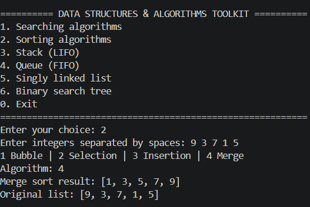
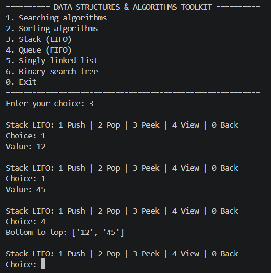
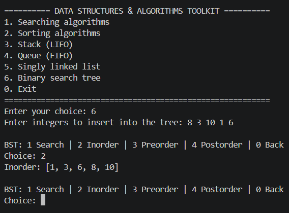

# Data Structures and Algorithms Toolkit

A Python command-line program for trying out common searching and sorting algorithms and a few core data structures. The menu lets you run operations and see the results without needing any third-party packages.

## What's included

### Searching
- Linear search — O(n)
- Binary search — O(log n); input must be sorted

### Sorting
- Bubble sort — O(n²)
- Selection sort — O(n²)
- Insertion sort — O(n²)
- Merge sort — O(n log n)

### Data structures
- Stack — push, pop, peek and display
- Queue — enqueue, dequeue, front and display
- Singly linked list — append, prepend, find and delete
- Binary search tree — insert, search and traversals

## Requirements

- Python 3.10 or newer recommended
- No external packages required

## Run it

Clone the repository and move into the project directory:

```bash
git clone https://github.com/logicsingh/data-structures-algorithms-toolkit.git
cd data-structures-algorithms-toolkit
python main.py
```

If your system uses `python3`, run `python3 main.py`.

## Run the tests

```bash
python -m unittest discover -s tests -v
```

The tests cover the searching and sorting functions, linked-list operations, stack and queue behaviour, and binary-search-tree operations.

## Project layout

```text
data-structures-algorithms-toolkit/
├── dsa_toolkit/
│   ├── binary_search_tree.py
│   ├── linked_list.py
│   ├── queue.py
│   ├── searching.py
│   ├── sorting.py
│   └── stack.py
├── tests/
├── screenshots/
└── main.py
```

## Screenshots

### Sorting algorithms


### Stack operations


### Binary search tree


## Notes

This is a small learning project, so the implementations are intended to make the underlying operations easy to read and compare. For example, binary search only works correctly when the input is sorted. The time complexities above describe the usual algorithmic running time; actual performance depends on the input size and implementation.

## License

MIT. See [LICENSE](LICENSE).
