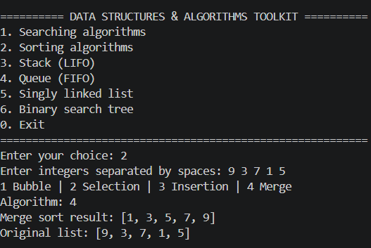
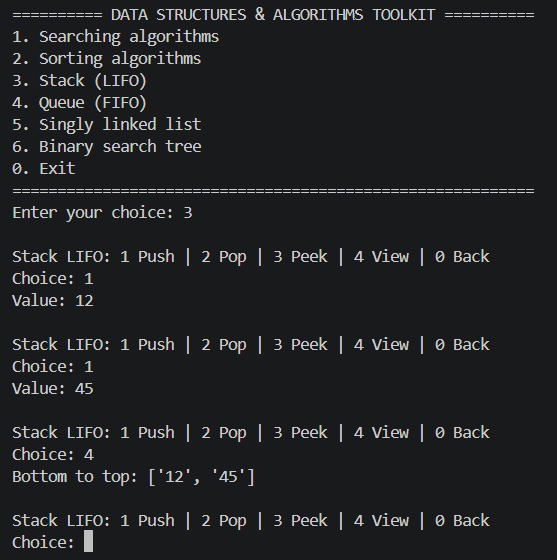
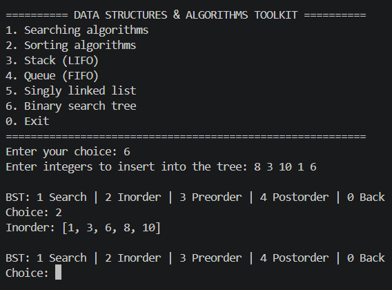

# Data Structures and Algorithms Toolkit

A beginner-friendly Python command-line project demonstrating searching algorithms, sorting algorithms, and fundamental data structures.

## Features

### Searching Algorithms
- Linear Search — O(n)
- Binary Search — O(log n), requires sorted input

### Sorting Algorithms
- Bubble Sort — O(n²)
- Selection Sort — O(n²)
- Insertion Sort — O(n²)
- Merge Sort — O(n log n)

### Data Structures
- Stack: Push, pop, peek, and view (LIFO)
- Queue: Enqueue, dequeue, front, and view (FIFO)
- Singly Linked List: Append, prepend, find, and delete
- Binary Search Tree: Insert, search, and tree traversals

### Other Features
- Interactive command-line menu
- Modular Python code
- Automated tests using `unittest`
- No third-party dependencies

## Application Screenshots

### Sorting Algorithms


### Stack Operations


### Binary Search Tree


## Technologies Used
- Python
- Python Standard Library
- unittest
- Git and GitHub

## Requirements
- Python 3.10 or newer recommended

## Getting Started

Clone the repository:

```bash
git clone https://github.com/logicsingh/data-structures-algorithms-toolkit.git
cd data-structures-algorithms-toolkit